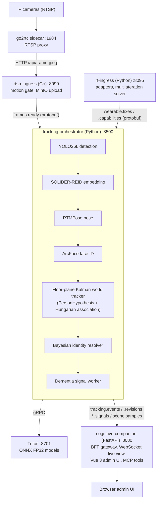
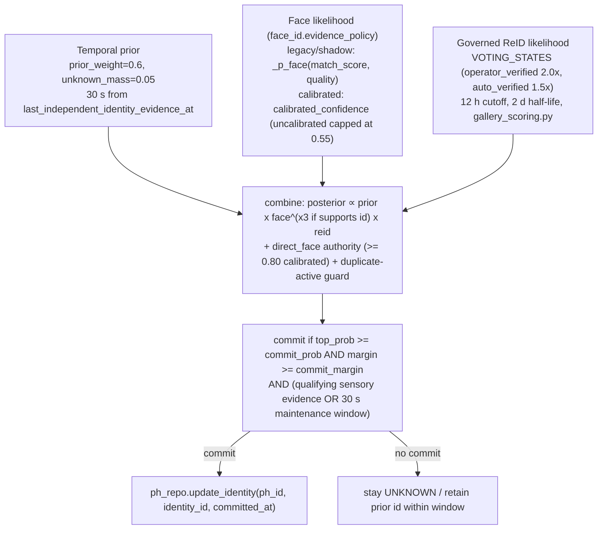
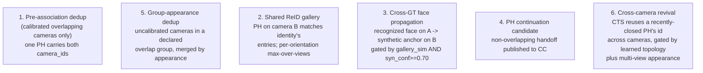
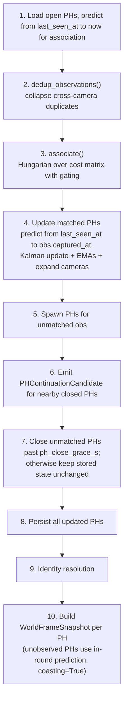

# Systems Architecture: Continuous Tracking System (CTS)

This is the CTS-focused architecture reference: `rtsp-ingress` and `tracking-orchestrator`, the live PersonHypothesis (PH) world-tracker identity model, the home-camera nuances, the settings coupling rule, and the contract by which CTS feeds cognitive-companion (CC). For the CC-side reference (sensors, rules, triggers, steps, the PWA companion view, Gemini integration, and CC bugs/gaps) see `cognitive-companion/docs/systems-architecture.md`.

The code is the source of truth. Some per-repo docs lag behind it (they may still say BoT-SORT, tracklets, or GlobalTrack); the live system uses none of those. Verify a named symbol still exists before relying on it.

## The three systems

- **continuous-tracking/** is the CTS family. **rtsp-ingress** (Go) pulls camera frames through a go2rtc sidecar, motion-gates, uploads JPEGs to MinIO, and publishes `frames.ready`. **rf-ingress** (Python, port 8095, opt-in via `--profile wearables`) turns RF hardware or simulator reports into hardware-neutral `TagFix` messages on `wearable.fixes` and `AdapterCapability` heartbeats on `wearable.capabilities` using site config polled from CC. **tracking-orchestrator** (Python, the ML brain, port 8500) consumes frames and runs detection, tracking, identity resolution, and dementia signals. **triton-shared/** is a sibling library providing the Triton gRPC client shared by CTS and scene-analysis-service. **cts-contracts/** is a sibling library providing shared signal vocabularies, wearable/RF-node closed enums (`cts_contracts.wearables`), camera-role enums (`CameraRole`), and pinhole optics helpers (`cts_contracts.optics`) shared by CTS and cognitive-companion.
- **cognitive-companion** (CC, port 8080) is the BFF gateway and rules engine. It consumes the CTS streams, serves the Vue 3 admin UI and MCP tools, and integrates a broad set of sensors and actuators beyond CTS. CC is the only system users and the browser talk to.

Data flow: cameras to go2rtc to rtsp-ingress to `frames.ready` to tracking-orchestrator to `tracking.events` / `tracking.revisions` / `tracking.signals` / `scene.samples` to cognitive-companion to UI, MCP, and rules.

## tracking-orchestrator: tracking and identity model

The architecture is a single floor-plane Kalman world tracker over PersonHypothesis (PH) with a Bayesian identity resolver. It is not BoT-SORT, per-camera tracklets, or GlobalTrack (those were removed).

- **PersonHypothesis (PH)** (`app/domain/__init__.py`, frozen dataclass) is the one cross-camera person entity. `ph_id` (UUID string) is the only person id on the wire. It carries Kalman `state_mean (x, y, vx, vy)` and `state_cov` in floor metres, `gallery_mean` (EMA SOLIDER embedding), `height_estimate_m`, `active_cameras`, `mean_quality` (EMA of CropQuality), and `current_identity_id` plus `current_identity_committed_at`.
- **Frame pipeline** (`app/pipeline/frame_pipeline.py`): 18 ordered `FrameStage`s run by `StageRunner` (17 default stages plus conditional `FallDetectionStage` when `fall_detection.enabled`). A stage is live only if it is in the `stages` list built in `initialize()`. Frames consumed from `frames.ready` are processed at most once and always acknowledged (on success, staleness drop, or terminal failure via `_finish_frame`); failed frames increment `cts_frames_failed_total` and are never left in the Redis Stream PEL to be reprocessed. On startup, `RedisStreamsTransport` reclaims and acknowledges any stale pending entries older than `redis.pending_reclaim_min_idle_s`. `FetchStage` reports observed frame dimensions to `CalibrationState` (exposed on `GET /internal/calibration/status`) and logs `camera_stream_size_mismatch` once if they differ from the synced `CameraProfile`. `ProvenancePersistStage` and `ReIDCandidateStage` run immediately ahead of `PublishStage` so identity-decision provenance and governed gallery candidate creation are never dropped by `PublishStage`'s per-camera `live_publish_max_hz` throttle.

- **WorldTracker.step** (`app/tracking/world/tracker.py`): predict open PHs, `dedup_observations`, `associate` (Hungarian over `cost_matrix.pair_cost` with a geometric chi-squared gate and an identity-conflict hard gate), update matched (Kalman + EMAs), spawn unmatched, emit `PHContinuationCandidate`, close stale, persist, identity resolution, build snapshots.
- **Identity resolver** (`app/tracking/identity_resolver.py`): posterior over `{identities} + {UNKNOWN}` from a temporal prior (`prior_weight = 0.6`, `unknown_mass = 0.05`, cannot commit alone), a face likelihood (ArcFace, `face_weight_multiplier = 3.0`), and a governed ReID gallery likelihood (logistic on cosine similarity over `VOTING_STATES = (operator_verified, auto_verified)` within the 12-hour `gallery_vote_max_age_s` cutoff, scored via `app/tracking/identity/gallery_scoring.py`). Height likelihood is currently uniform (`Observations` carry `height_estimate_m=None` until single-view height metrology is enabled). Face emission and weighting follow `face_id.evidence_policy` (`legacy`, `shadow`, `calibrated`): under `legacy` (and live decisions under `shadow`), recognized faces at or above `face_id.min_raw_similarity` (0.60) use the uncalibrated heuristic `_p_face = 0.5 + 0.5 * tanh(4 * (0.7 * match_score + 0.3 * q - 0.5))` with `resolver.face_quality_mode`; under `calibrated`, recognized faces use `calibrated_confidence` directly (scaled by head-yaw frontality), while faces without `calibrated_confidence` are capped at `resolver.uncalibrated_face_max_likelihood` (0.55) and corroborate only. Direct calibrated ArcFace evidence at or above `arcface_authority_calibrated_confidence` (0.80) grants `direct_face` authority. When `face_templates.mode` is active, `FaceTemplateBuffer` aggregates up to 8 attributed faces of one PH over 15 s and matches them via `POST /api/v1/match-template` against a dedicated `template` calibration profile. The resolver commits when `top_prob >= commit_prob (0.65; dense 0.80)` and `margin >= commit_margin (0.15; dense 0.20)` and qualifying sensory evidence is present (or the PH is inside its 30 s maintenance window, measured from `last_independent_identity_evidence_at`). The duplicate-active-identity guard enforces that at most one open PH holds a household identity.

- **How a prior PH gets its identity on a good face signal**: FaceIdentityStage emits a `FaceAnchor` keyed by `detection_id`. After association, `WorldTracker._resolve_identities` remaps `tracklet_id` to `ph_id` via `det_to_ph`. The resolver matches the anchor to the PH by `entity_id`. The 3x face weight pushes the posterior past the commit threshold, and `ph_repo.update_identity(...)` is called. If the identity changed, an `IdentityRevision` is published and RevisionsStage retroactively rewrites past trajectory, dwell, and signal rows (`app/services/identity_rewriter.py`).
- **Cross-camera identity** travels six ways (paths 5 and 6):

For overlapping cameras with opposite perspectives (front on A, back on B), CTS does not merge observations (their direct similarity is low); both PHs resolve to the same identity through the multi-view gallery and are linked by a **co-presence record** (`co_presence_links`, written when two open PHs in one overlap group share a committed identity).

### WorldTracker.step: the 10-step loop

Each frame, `WorldTracker.step` (`app/tracking/world/tracker.py`) runs on the capture-time clock (`now = max(ctx.capture_time)`):

### Home-camera nuances (load-bearing)

- **Uncalibrated cameras get synthetic floor points, not garbage.** `WorldTrackingStage._synthetic_floor_point` maps the bbox centre into a 4 m virtual room inside a per-camera 200 m tile, flagged `calibrated=False`, so the tracker still creates PHs and commits face-based identities. (Before this, uncalibrated detections were filtered out, so there were no PHs and no identities.)
- **Floor-distance dedup skips `calibrated=False` observations.** Geometric cross-camera dedup does nothing for uncalibrated cameras. For uncalibrated cameras in a declared overlap group, an appearance-based group dedup path (`enable_group_appearance_dedup`) merges them; groups are applied on every CC config sync poll, so a new group needs no restart. Otherwise identity crosses uncalibrated cameras via the ReID gallery, face propagation, PH continuation, and cross-camera revival.
- **Uncalibrated geometry gates more loosely.** Synthetic floor points jump as a person walks, so Widens the association gate for `calibrated=False` observations (`uncalibrated_gate_chi2 = 21.0`) and weights appearance over geometry, preventing a turning or walking person from being dropped and respawned.
- **The single quality scorer** is `CropQuality` at `app/pipeline/crop_quality.py`. The formula is `quality = clamp(0.30*area + 0.30*conf + 0.20*kp - 0.4*edge_truncated, 0, 1)` (max 0.60 without pose). It scales per-observation pixel covariance `Sigma_px` in `app/tracking/world/observation_model.py`, selects which cluster member carries representative metadata in cross-camera dedup (while the representative's floor position and covariance come from information-form inverse-covariance fusion `fuse_information_form` plus a non-shrinking calibration bias floor `R_bias_floor`), and feeds gallery candidate eligibility, keyframe sampling, and the PH `mean_quality` EMA that travels to CC. Do not add a second scorer; do not recompute quality on the CC side.

### Robustness: continuity, multi-view, and zero-calibration cross-camera

The robustness milestones target the dominant home-deployment failure: a person who turns or walks loses their PH or identity label, the dashboard fills with short-lived PHs, and identity does not survive a camera handoff. The policy under weak evidence is favor continuity: hold a confident identity rather than dropping to UNKNOWN, and minimize PH churn. Each mechanism shipped behind a config flag with a frame-replay proof and an anti-identity-bleed guardrail (a stranger never inherits a resident's identity).

| Mechanism | Where | What it does |
| --- | --- | --- |
| Sticky maintenance | `identity_resolver._evaluate_commit` | Holds a committed identity within the maintenance window unless a recognized different-identity face or a strong contradicting posterior overturns it. A candidate or unrecognized face never contradicts. |
| PH revival | `tracker.py` step 5, `world/revival.py` | Before spawning a new UNKNOWN PH, revives a recently-closed same-camera PH that matches on space, time, and appearance, reusing its `ph_id`, identity, and gallery state. |
| Uncalibrated gate relaxation | `cost_matrix.pair_cost` | Wider geometric gate and appearance-weighted cost for synthetic-floor-point observations. |
| Three-valued face evidence + pose | `person-identification-service`, `face_identity.py`, resolver | Face evidence is `recognized` / `candidate` / `unrecognized` plus head yaw and face quality (`heuristic-v1`). A grey-zone candidate corroborates a held identity; a face-present-unknown nudges UNKNOWN without harming a held identity; off-axis matches are down-weighted by frontality. |
| Multi-view ReID | `orientation.py`, `cost_matrix.py`, resolver `_from_gallery_multiview` | Per-observation body orientation (front/back/left/right) builds view-binned prototypes per PH and per identity. Association and the gallery query match by the best view (max-over-views), so a person who turned around is still retrievable. `ReIDCandidateStage` is the sole governed pipeline write path into `reid_gallery` (`pending_review` or `auto_verified` when calibrated face confidence is at or above `0.90`). |
| Camera topology | `world/topology.py`, `camera_topology_edges` | Learns directed handoff edges with a transit-time distribution online; feeds the cross-camera revival plausibility check. The delay is measured from the earlier PH's `closed_at` (at least `ph_close_grace_s` after its last sighting), so it is delay after closure, not walk time; the check's floor equals `cross_camera_min_plausibility`, so it rejects nothing today. Operators do not edit it; CC shows it read-only (`GET /internal/topology/transitions`). |
| Cross-camera revival + co-presence | `world/revival.py`, `co_presence_links` | Acts on handoffs inside CTS (not just publishing to CC); links overlapping opposite-perspective cameras at the identity level. |
| Inferred backfill | `UnknownBackfillService`, `RevisionsStage` | On a qualifying first `direct_face` commit of a previously Unknown PH, relabels preceding identity-NULL `person_trajectories` and `room_dwells` rows within `backfill_max_range_s` (4 h) and publishes an `inferred_backfill` revision (`enable_unknown_backfill`, `backfill_shadow`). |

The multi-view gallery query holds residual mass on UNKNOWN for weak matches, so with a single enrolled identity a non-matching body cannot normalize to that identity. Held-identity confidence is replayed on coasting frames (a per-PH in-process cache bounded to open PHs) so a carried identity keeps a meaningful posterior instead of a sentinel 0.

### Settings coupling gotcha

`config/settings.yaml` keys are read in `app/main.py` `_build_*` functions via `section(...).as_float("key")` with no default. Deleting a YAML key without removing its `main.py` read crashes startup with `SettingNotFoundError`; adding a key without a read silently ignores it. Treat the YAML key, the `main.py` read, the dataclass field, and the test as one atomic unit.

## rtsp-ingress: go2rtc ingest and camera configuration

### go2rtc sidecar

`rtsp-ingress` does **not** manage RTSP sessions directly. go2rtc owns all RTSP sessions. The flow per camera:

1. `reconciler` fetches the enabled camera list from `GET /api/v1/cts/cameras` on cognitive-companion (polled every 60 s)
2. `Supervisor.Reconcile()` calls `go2rtc.RegisterStream(ctx, cameraID, rtspURL)` -- idempotent HTTP PUT to go2rtc `/api/streams`; heals go2rtc restarts
3. `poll.Worker` ticks every `frame_interval_ms` ms, records the fetch-start wall-clock instant before calling `go2rtc.FetchJPEG(ctx, cameraID)` (HTTP GET `/api/frame.jpeg`), and records `receivedAt` after JPEG decode and rotation. `CaptureTimeUnixNs` is stamped as `fetchStart - capture_latency_ms` (never later than `fetchStart`) and `ReceivedTimeUnixNs` as `receivedAt`. Each fetch can make go2rtc open an RTSP session, so after a failed fetch (or a truncated frame) the worker waits `reconnect_backoff_s`, doubling per consecutive failure up to `reconnect_backoff_max_s`, and resets on the first good frame. `rtsp_camera_backoff_seconds{camera_id}` shows the current wait (0 while healthy); `rtsp_last_fetch_success_timestamp_seconds{camera_id}` and `rtsp_last_frame_published_timestamp_seconds{camera_id}` track ingest liveness; a failing camera logs one `fetch_failed`/`jpeg_decode_failed` per attempt and `fetch_recovered` when it returns
4. Frame passes the motion gate (`motion.Gate`), uploads to MinIO, and publishes to `frames.ready`. In `cells` mode (`defaults.motion_mode: cells`), the 320x180 grayscale frame is divided into a 16x9 grid of 20x20 px cells. Motion fires when at least `motion_min_cells` cells have a mean absolute delta at or above `motion_cell_threshold` against either the previous polled frame or the last published frame (so slow movement accumulates across polls), or when the whole-frame mean delta exceeds `motion_threshold`. Once motion fires, the worker continues publishing subsequent polled frames for `motion_hold_s` seconds (default 3.0 s) so a walking person continues producing frames across the room.

`rtsp-ingress/config/go2rtc.yaml` has **no `streams:` section** -- all registrations are dynamic. Do not add `gortsplib` or `pion/rtp` to this codebase.

### Camera configuration

All cameras are managed through the cognitive-companion Admin UI (`/admin/cts/cameras`). There is no static camera list in `settings.yaml`.

rtsp-ingress polls `GET /api/v1/cts/cameras` on cognitive-companion every 60 s (configurable via `cognitive_companion.reconcile_interval_s`). The reconciler maps each camera record to a `CameraConfig` and calls `Supervisor.Reconcile()`, which registers/deregisters streams with go2rtc idempotently.

`CameraConfig` fields populated from the API response:

| Field | Source |
| --- | --- |
| `ID` | `cts_cameras.id` |
| `RTSPURL` | `cts_cameras.rtsp_url` -- full RTSP URL stored in the database |
| `RoomName` | `cts_cameras.location` |
| `Enabled` | only enabled cameras are included (filtered Go-side) |
| `FrameIntervalMs` | falls back to `defaults.frame_interval_ms` from settings.yaml |
| `CaptureLatencyMs` | falls back to `defaults.capture_latency_ms` (subtracted from fetch start to stamp `CaptureTimeUnixNs`) |
| `MotionThreshold` | falls back to `defaults.motion_threshold` |
| `MotionMode` | falls back to `defaults.motion_mode` (`cells` or `frame_mean`) |
| `MotionCellThreshold` | falls back to `defaults.motion_cell_threshold` |
| `MotionMinCells` | falls back to `defaults.motion_min_cells` |
| `MotionHoldSeconds` | falls back to `defaults.motion_hold_s` |
| `ReconnectBackoffSeconds` | falls back to `defaults.reconnect_backoff_s` (first retry delay after a failed fetch) |
| `ReconnectBackoffMaxSeconds` | falls back to `defaults.reconnect_backoff_max_s` (cap on the doubling retry delay) |

rtsp-ingress authenticates to cognitive-companion with the `COGNITIVE_API_KEY` environment variable (sent as `X-API-Key`). The key must have the `cts_ingress` permission defined in `cognitive-companion/config/auth.yaml`. The `CC_INGRESS_API_KEY` env var should hold the same secret on both services.

RTSP credentials are stored in the cognitive-companion database as part of the full RTSP URL. They are never written to any config file on the rtsp-ingress side.

## rf-ingress: hardware-neutral RF localization ingress

`rf-ingress` (`continuous-tracking/rf-ingress/`, port `8095`, opt-in compose profile `wearables`) mirrors `rtsp-ingress` for wearable RF localization:

1. **Adapter boundary:** all hardware and simulator sources sit behind `RangeAdapter`, `PositionAdapter`, and `RoomAdapter` protocols (`rf_ingress/adapters/base.py`) resolved by `AdapterRegistry` (`rf_ingress/adapters/registry.py`). The core ships with the deterministic `simulator` adapter (covering UWB, BLE Channel Sounding, BLE RSSI with body-shadow steps, burst-batched delivery, native-frame positions, room reports, and JSONL replay), the `device_ranging_mqtt` adapter (`payload_profile: device_ranging_v1`, subscribing to `rf/devices/+/ranges` for micro-batched wearable range epochs), and an adapter conformance kit (`rf-ingress/tests/conformance/`) that every hardware adapter must pass unchanged.
2. **Per-epoch solving, no cross-epoch smoothing:** `EpochBuilder` (`rf_ingress/solver/epoch.py`) groups ranges per tag by `epoch_seq` or `epoch_window_s` (0.25 s) and drops open epochs whenever CC's `version` changes. `MultilaterationSolver` (`rf_ingress/solver/multilateration.py`) weights strictly by `variance_m2`, rejects only degenerate/collinear geometry (never wide covariance), performs leave-one-out chi-square outlier rejection on 4+ nodes, and ignores `device_local` wrist azimuth. Epochs with fewer than 3 nodes emit `FIX_KIND_ROOM` via `room_fallback_from_epoch`.
3. **Clock alignment and registration gate:** `BurstClockOffsetTracker` (`rf_ingress/clock.py`) decouples multi-second micro-batch flushing from device clock skew via minimum-delay `arrival - sent_at` estimation. `RegistrationGate` (`rf_ingress/registration.py`) publishes only registered, active, currently bound tags (passing `wear_state` and `motion_state` through truthfully to CTS).
4. **Stream publishing and replay:** `RedisTagFixPublisher` (`rf_ingress/publish.py`) publishes raw `TagFix` protobufs on `wearable.fixes` (field `"fix"`, trimmed with `MINID` to 72 hours) and `AdapterCapability` heartbeats on `wearable.capabilities` (field `"capability"`, every 60 s). `python -m rf_ingress.replay` records raw reports (capped at 60 minutes) and replays them through the simulator.
5. **Wear OS companion app (`wear-companion/`):** optional Kotlin multi-module project (`:core` pure JVM, `:app` Wear OS with `bleOnly` and `dualMode` product flavors). `bleOnly` advertises a static local iBeacon on-body with zero network or UWB permissions in its manifest; `dualMode` adds opt-in motion-duty-cycled 12 s FiRa UWB bursts (token-bucket 120 s/h budget, 20% battery and thermal cutoffs) flushed every 3 s over LAN MQTT as `device_ranging.v1` to `rf-ingress`'s `device_ranging_mqtt` adapter.

## How CTS interacts with cognitive-companion (CC)

CC is the consumer and control plane for CTS. CTS does not serve users directly; everything user-facing is in CC. The integration surface is deliberately narrow:

- **CTS publishes, CC subscribes.** The orchestrator emits protobuf on Redis Streams (see Wire contract below). CC consumes them inside `CTSRuntime` and its subscribers (`backend/services/cts/`): `tracking_event_subscriber` (presence and locations), `identity_revision_subscriber` (applies retroactive identity corrections to CC history), `dementia_signal_subscriber` (fires `dementia_signal`-triggered rules), `ph_continuation_subscriber` (links inferred handoffs), and `scene_sample` consumers.
- **CC owns camera configuration and profiles.** There is no static camera list in CTS. `rtsp-ingress` polls `GET /api/v1/cts/cameras` on CC every 60 s; CC stores RTSP URLs (with embedded credentials), room bindings, and enable flags. Operators manage cameras in the CC admin UI. The orchestrator's `cc_config_sync` reads the same list for room bindings, homographies, overlap groups, each camera's `privacy_zones`, and hardware-neutral `CameraProfile`s held in `CameraProfileMap` (`app/services/camera_profile_map.py`: `role` in `face_capable` / `mixed` / `surveillance`, `face_id_enabled`, `face_id_min_raw_similarity`, `horizontal_fov_deg`, `mounting_height_m`, `tilt_deg`, `ir_capable`, `frame_natural_width_px`, `frame_natural_height_px`). `FaceIdentityStage.face_id_policy_for(camera_id)` applies `face_id.identification_point_cooldown_s` (`1.0 s`) to `face_capable` cameras and `face_id.cooldown_s` (`5.0 s`) to `mixed` and `surveillance` cameras (`face_id_enabled` is the sole disable switch). Privacy zones live only in orchestrator memory, so `restore_privacy_zones` loads them before the pipeline starts (startup fails without them) and every sync poll re-applies them; CC's `POST /internal/calibration/privacy_zones` push only makes a saved change take effect sooner.
- **Automated identity roster synchronization and purge.** `IdentityRosterSyncService` (`app/services/identity_roster_sync.py`) runs at startup and every 60 s against `person-identification-service` (`GET /api/v1/members`), purging any unenrolled identity and its dependent rows through `GalleryRepository.purge_identity(identity_id)` and invalidating `IdentityResolver`'s identity cache (`invalidate_identity_cache()`). CTS exposes `POST /internal/gallery/identities/sync` and `DELETE /internal/gallery/identities/{identity_id}`, which CC `backend/routers/persons.py` triggers immediately upon member enrollment and member deletion.
- **CC drives identity corrections and governed gallery review.** The CC BFF proxies the orchestrator `/ph/*`, `/internal/corrections/*`, `/internal/keyframes/grouped`, and `/internal/reid-review/*` endpoints. Operator corrections create observation-bounded revision ranges and projection jobs (`IdentityRevision` on `tracking.revisions`), which complete only after both CTS and CC (`POST /internal/projection-acks`) acknowledge the same `revision_id`.
- **CC injects external face evidence back into CTS.** CC publishes `CCIdentityAssertion` protobuf messages on the `cc.identity_assertions` Redis stream (consumed by `CCIdentityAssertionSubscriber` and spatially/room matched to observations by `WorldTrackingStage` via `app/tracking/world/assertion_matching.py`, governed by `resolver.cc_assertion_mode`).
- **CC reads identity readiness from CTS.** `GET /internal/identity/readiness`
  (`app/routers/readiness.py`, `IdentityReadinessService`) reports the face, template, quality,
  and assertion policies the pipeline was built with, ReID gallery rows by lifecycle state, each
  enabled camera with whether a homography is in use, and the overlap-group count. It carries
  counts and settings only, never an identity id or a position; CC turns it into the identity
  setup page and the `get_identity_readiness` MCP tool.
- **`mean_quality` and identity confidence travel on the wire** from CTS to the CC `PersonLocationEnvelope`. CC does not recompute them.
- **Trajectory confidence is persisted for signal gating.** CTS stores `position_sigma_m`,
  `primary_camera_id`, `contributing_camera_count`, and `footpoint_reliable` on each
  `person_trajectories` row so dementia detectors can demote low-confidence evidence.
- **CC enriches CTS signals with caregiver context.** `DementiaSignal`s become alerts only after CC applies per-person `cts_alert_config` gating and rule pipelines; CTS itself never decides whether to notify.

For everything on the CC side (the rules engine and its eight trigger types, event aggregation, the 28 step types, 7 channels and 13 filters, the PWA companion view, Gemini Live realtime voice, Home Assistant and reCamera sensors, and the `PersonLocationService` SSOT) read `cognitive-companion/docs/systems-architecture.md`.

## Wire contract (CTS and CC)

Redis Streams carry raw protobuf bytes (no JSON, no base64); clients set `decode_responses=False`. Active protobuf streams: `frames.ready` (`FrameReady`, `rtsp-ingress` to `tracking-orchestrator`), `tracking.events` (`TrackingEvent` with `identity_snapshots`), `tracking.revisions` (`IdentityRevision`), `tracking.signals` (`DementiaSignal`), `scene.samples` (`SceneSample`), and inbound `cc.identity_assertions` (`CCIdentityAssertion`, `cognitive-companion` to `tracking-orchestrator`). Two streams are exceptions that publish one Redis field per value instead of a protobuf message: `tracking.continuations` (`PHContinuationCandidate` fields) and `tracking.room_transitions` (`RoomTransitionEvent` fields). `PresenceEvent` (`tracking.presence`) and `DwellEvent` (`tracking.dwell`) are declared in `proto/continuoustracking/v1/tracking.proto` (`deprecated = true`) with settings keys and metrics, and nothing publishes them today. Proto changes are two-repo changes: edit the `.proto`, regenerate bindings in both repos (`make proto`), and update producers, consumers, and tests together; never reuse field numbers. PH `mean_quality` travels via the `IdentitySnapshot` proto to the CC `PersonLocationEnvelope` `quality` field; do not recompute quality on the CC side. See [docs/wire-format.md](wire-format.md) for the complete per-stream table.

**Two-tier event model.** `tracking.events` is a high-rate live feed for the UI only, throttled per camera by `live_publish_max_hz` (default 3 Hz; inference still runs every frame). The Tier-2 streams (`tracking.transitions`/room transitions, `tracking.presence`, `tracking.dwell`, `tracking.revisions`, `tracking.signals`) are emitted only on semantic state changes, so the CC rule-trigger rate is a function of human activity, not frame rate times camera count. Raising the inference poll rate to improve tracking no longer increases CC rule load. The CTS-side publish policy is implemented; the CC-side consumer migration (rules triggering off Tier-2 rather than per-frame) is specified for a later effort .

## Conventions that bite if ignored

- Virtual environments: CTS `tracking-orchestrator/.venv` and `rf-ingress/.venv`; CC `backend/.venv`. Never use the system Python.
- CTS gates: `make check` (fast), `make ci` (authoritative, Docker, runs the world-tracker replay proofs and PH repository parity). CC gates: `make check`, `make check-all`, `make test-integration`. Tracker or identity changes run in shadow with a mismatch metric and a frame-replay proof before becoming authoritative.
- asyncpg `$1..$N` params only; schema-qualify every table as `continuous_tracking.<table>`; `datetime.now(UTC)` always; frozen dataclasses plus `dataclasses.replace()`; `structlog` only; no silent fallbacks (ruff `BLE001` is an error; stream consumers XACK, warn, and increment `cts_messages_dead_lettered_total`).
- No em-dashes in Markdown. Test at the Protocol boundary with InMemory implementations; assertions must be falsifiable.
